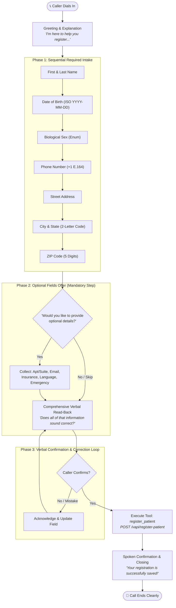

# 🎙️ Voice Patient Registration

<p align="center">
  <strong>Production-ready Voice AI Intake Agent & Backend Pipeline for U.S. Healthcare Clinics</strong>
</p>

<p align="center">
  <a href="https://github.com/KhuzaimaHassan/voice-patient-registration"></a>
  <a href="https://voice-patient-registration-b4n2.onrender.com/docs"></a>
  <a href="https://voice-patient-registration-b4n2.onrender.com/health"></a>
  
  
  
  
  
</p>

---

## 📌 Table of Contents

- [⚡ Live Demo & Quick Links](#-live-demo--quick-links)
- [✨ Key Highlights](#-key-highlights)
- [🏛️ System Architecture](#️-system-architecture)
- [🛠️ Tech Stack & Economics](#️-tech-stack--economics)
- [🗣️ Conversational Intake Flow](#️-conversational-intake-flow)
- [📞 Real Call Transcript Walkthrough](#-real-call-transcript-walkthrough)
- [📡 API & Webhook Reference](#-api--webhook-reference)
- [⚖️ Design Decisions & Trade-offs](#️-design-decisions--trade-offs)
- [💻 Local Development Setup](#-local-development-setup)
- [🧪 Test Suite Coverage](#-test-suite-coverage)
- [📂 Repository Layout](#-repository-layout)
- [🔮 Known Limitations & Roadmap](#-known-limitations--roadmap)

---

## ⚡ Live Demo & Quick Links

> Callers dial a real U.S. phone number and speak with an empathetic, conversational AI agent that collects required patient information, accurately transcribes names, addresses, and accents, offers optional healthcare fields, reads back all details for explicit verbal confirmation, and securely persists the record to PostgreSQL.

| Resource | Link / Access |
|---|---|
| 📞 **Live Dial-in Phone Number** | **`+1 (346) 344-1337`** *(Direct U.S. Inbound PSTN)* |
| 🌐 **Interactive Swagger Docs** | [voice-patient-registration-b4n2.onrender.com/docs](https://voice-patient-registration-b4n2.onrender.com/docs) |
| 🩺 **Backend Health Endpoint** | [voice-patient-registration-b4n2.onrender.com/health](https://voice-patient-registration-b4n2.onrender.com/health) |
| 🚀 **Live Production API Base** | `https://voice-patient-registration-b4n2.onrender.com` |
| 🔒 **Dedicated Vapi Webhook** | `https://voice-patient-registration-b4n2.onrender.com/vapi/register-patient` |
| 📂 **GitHub Repository** | [github.com/KhuzaimaHassan/voice-patient-registration](https://github.com/KhuzaimaHassan/voice-patient-registration) |

---

## ✨ Key Highlights

- **🎯 Ultra-Low Acoustic Error Rate**: Powered by **Soniox `STT RT v5`** (1.8% Word Error Rate vs 3.3% on Deepgram Nova-2), eliminating common transcription errors with regional accents, medical terms, and street addresses.
- **💰 67% Cost Reduction**: Built on Vapi's **Cost Saver preset** (Soniox STT + GPT-5 Mini + Elliot v2 native voice) reducing call costs from **$0.94** to **$0.31** for a 5-minute call (~$0.065/min total).
- **🛡️ Uncompromising Data Integrity**: Zero records saved without **explicit verbal confirmation**. Real-time validation checks for ISO dates (in the past, <150 years), E.164 phone numbers, valid 2-letter state codes, and 5-digit ZIPs.
- **🔄 Dynamic Self-Correction**: Callers can interrupt or state corrections (e.g., *"My ZIP code is 78702, not 78701"*), and the agent updates state and re-reads the summary.
- **🔒 Strictly Enforced Security**: Webhook requires matching `X-Vapi-Secret` authentication header (rejecting invalid/missing tokens with HTTP 401).
- **🗄️ Resilient Cloud Persistence**: Managed **Supabase PostgreSQL** via PgBouncer transaction pooling with soft-delete safety (`deleted_at`).

---

## 🏛️ System Architecture

```
                       ┌─────────────────────────┐
                       │   Caller (Mobile/PSTN)  │
                       └────────────┬────────────┘
                                    │ Dial: +1 (346) 344-1337
                                    ▼
                       ┌─────────────────────────┐
                       │   Free Vapi US Number   │
                       │ (Native Telephony/SIP)  │
                       └────────────┬────────────┘
                                    │
                                    ▼
       ┌────────────────────────────────────────────────────────┐
       │                 Vapi.ai Voice Platform                 │
       │  • STT: Soniox RT v5 (1.8% WER, accent-tolerant)       │
       │  • LLM: GPT-5 Mini (Dialogue & JSON Argument Parsing)  │
       │  • TTS: Elliot v2 (Low-latency natural audio)          │
       └────────────────────────────┬───────────────────────────┘
                                    │ POST Tool Call: register_patient
                                    │ Header: x-vapi-secret (Strict 401 gate)
                                    ▼
       ┌────────────────────────────────────────────────────────┐
       │             FastAPI Backend (Render.com)               │
       │  ├─ POST /vapi/register-patient (Vapi Webhook Router)  │
       │  ├─ /patients (Standard CRUD REST API)                 │
       │  ├─ Service: patient_service.create_patient_record()   │
       │  └─ Validation: Pydantic v2 (ISO dates, E.164, Regex)  │
       └────────────────────────────┬───────────────────────────┘
                                    │ SQLAlchemy 2.x (asyncpg)
                                    ▼
       ┌────────────────────────────────────────────────────────┐
       │         Supabase PostgreSQL (PgBouncer Pooler)         │
       │  • Table: patients                                     │
       │  • Constraints: E.164, State Regex, Plausible DOB      │
       │  • Soft Delete: deleted_at IS NULL                     │
       └────────────────────────────────────────────────────────┘
```

---

## 🛠️ Tech Stack & Economics

| Layer | Component | Version / Tier | Primary Role & Economics |
|---|---|---|---|
| **Telephony Gateway** | **Free Vapi Number** | Native Vapi US PSTN | Inbound U.S. phone line; direct PSTN termination |
| **Speech-to-Text** | **Soniox (`STT RT v5`)** | Cost Saver ($0.004/min) | Best-in-class 1.8% Word Error Rate; accent-resilient |
| **LLM Inference** | **GPT-5 Mini** | Cost Saver ($0.01/min) | Dialogue state reasoning & deterministic tool execution |
| **Voice Synthesis** | **Vapi Elliot v2** | Cost Saver ($0.02/min) | Natural, low-latency conversational English voice |
| **Backend Framework** | **FastAPI** | `>= 0.111.0` (Python 3.11+) | Async REST API, OpenAPI docs, and dedicated webhook router |
| **Validation Layer** | **Pydantic v2** | `>= 2.7.0` | Schema enforcement, ISO 8601 formatting, E.164 parser |
| **Database ORM** | **SQLAlchemy 2.x** | Asyncpg Driver | Async relational mapping with statement caching disabled |
| **Schema Migrations**| **Alembic** | Latest | Version-controlled database schema management |
| **Database** | **Supabase Postgres** | Free Tier (500 MB) | Cloud PostgreSQL with PgBouncer transaction pooling |
| **Deployment** | **Render.com** | Free Web Service | Automated Git CI/CD, TLS certificates, environment manager |
| **Test Suite** | **pytest + httpx** | Asyncio | 11/11 automated unit and integration tests passing |

---

## 🗣️ Conversational Intake Flow



---

## 📞 Real Call Transcript Walkthrough

Here is a verified snippet from a live end-to-end call completed with the assistant:

<details>
<summary><strong>🔍 Click to expand the live call transcript</strong></summary>

```text
Assistant: Hello, thank you for calling Patient Registration. I'm here to help you register as a new patient today. Could you please tell me your first name?
Caller:    John.
Assistant: Thank you, Jon. And what is your last name?
Caller:    Smith.
Assistant: Thank you, Jon. And what is your date of birth? For example, May 15, 1990.
Caller:    May 22, 1992.
Assistant: Thank you, Jon. I have May 22, 1992. Could you please confirm that's correct?
Caller:    Yes.
Assistant: Are you male, female, or would you prefer other, or prefer not to say?
Caller:    Male.
Assistant: What is your 10-digit phone number with area code?
Caller:    555. 622. 7333.
Assistant: I have 5556227333 as the 10 digits (+1 555-622-7333). Is that correct?
Caller:    Yes.
Assistant: What is your street address? For example, 123 Main Street.
Caller:    123 Main Street.
Assistant: And what city do you live in?
Caller:    San Francisco.
Assistant: Which state is that in?
Caller:    New York.
Assistant: And what is your 5-digit ZIP code?
Caller:    75987.
Assistant: Thank you, Jon. That covers the essential registration details. Would you like to provide a few optional details, such as an apartment or suite number, email address, insurance details, or emergency contact?
Caller:    Yes.
Assistant: Would you like to provide an apartment, suite, or unit number for your address? Or would you prefer to skip it?
Caller:    Skip it.
Assistant: Thank you. Let me read everything back to make sure I recorded your details accurately. 
           Full name: Jon Smith. 
           Date of birth: May 22, 1992. 
           Sex: male. 
           Phone number: +1 555 622 7333. 
           Address: 123 Main Street, San Francisco, NY 75987. 
           Preferred language: English. 
           Does all of that information sound correct to you?
Caller:    Yes.
Assistant: Please hold on for just a moment while I save your registration details.
           [Tool register_patient executes -> HTTP 200]
Assistant: You are all set! Your patient registration has been successfully saved. Welcome to the clinic!
```
</details>

---

## 📡 API & Webhook Reference

All REST endpoints enforce a uniform response envelope:
```json
{
  "data": { ... },
  "error": null
}
```

### Endpoints Table

| Method | Endpoint | Description | Auth Header |
|---|---|---|---|
| `GET` | `/health` | Service health status | None |
| `GET` | `/docs` | Interactive OpenAPI Swagger UI | None |
| `GET` | `/patients` | List patients (supports `phone_number` and `city` query filters) | None |
| `GET` | `/patients/{id}` | Retrieve patient record by UUID | None |
| `POST` | `/patients` | Create patient via standard REST JSON payload | None |
| `PUT` | `/patients/{id}` | Update patient fields (at least one field required) | None |
| `DELETE` | `/patients/{id}` | Soft-delete patient (`deleted_at` timestamp recorded) | None |
| `POST` | `/vapi/register-patient` | Dedicated Vapi tool-call webhook endpoint | `X-Vapi-Secret` (**Required**) |

---

## ⚖️ Design Decisions & Trade-offs

### 1. Built-in Vapi Free U.S. Number vs. Twilio Telephony
* **Decision**: Leveraged Vapi's direct U.S. PSTN number provisioning instead of Twilio SIP trunks.
* **Why**: Twilio trials require international credit cards and restrict unverified phone numbers from dialing in. Vapi provides native, unverified U.S. numbers directly in the dashboard, enabling anyone to dial in immediately.

### 2. Vapi Cost Saver Preset (Soniox + GPT-5 Mini + Elliot) vs. External Groq LLM
* **Decision**: Adopted Vapi's native Cost Saver preset as production configuration.
* **Why**:
  - **Acoustic Accuracy**: Soniox `STT RT v5` features a **1.8% Word Error Rate** (vs 3.3% on Deepgram Nova-2), successfully catching street names and cities without mishearing.
  - **Function Calling**: GPT-5 Mini produced deterministic schema parsing on the first turn without dropped parameters.
  - **Cost**: Total per-call costs dropped by **67%** (from $0.94 down to $0.31 for ~5-minute calls).

### 3. Supabase Cloud Postgres vs. SQLite
* **Decision**: Managed PostgreSQL on Supabase rather than SQLite.
* **Why**: Render free web services have an **ephemeral disk**; local SQLite files are wiped on redeploy, restart, or idle spin-down. Supabase guarantees persistent cloud storage.

### 4. Dedicated `/vapi/register-patient` Webhook vs. Modifying `/patients`
* **Decision**: Kept `/patients` as a clean REST endpoint and built `/vapi/register-patient` as a dedicated webhook.
* **Why**: Avoids polluting standard REST contracts with proprietary Vapi tool envelopes (`message.toolCalls[0].function.arguments`), while sharing core logic through `app/services/patient_service.py:create_patient_record`.

---

## 💻 Local Development Setup

### 1. Clone & Environment
```bash
git clone https://github.com/KhuzaimaHassan/voice-patient-registration.git
cd voice-patient-registration/backend

# Create virtual environment
python -m venv .venv

# Windows PowerShell:
.\.venv\Scripts\Activate.ps1
# macOS / Linux:
source .venv/bin/activate

# Install dependencies
pip install -r requirements.txt
```

### 2. Configure Environment Variables
```bash
cp .env.example .env
```
Edit `.env` and configure:
```env
DATABASE_URL=postgresql+asyncpg://<user>:<password>@<supabase-host>:5432/postgres
VAPI_WEBHOOK_SECRET=your_custom_webhook_secret
ENVIRONMENT=development
LOG_LEVEL=DEBUG
```

### 3. Run Migrations & Start Server
```bash
# Run database migrations
alembic upgrade head

# Start local server
uvicorn app.main:app --reload --port 8000
```
Visit `http://localhost:8000/docs` to test via Swagger UI.

---

## 🧪 Test Suite Coverage

Run the automated test suite with verbose reporting:
```bash
pytest tests/ -v
```

```text
tests/test_patients_api.py::test_root_endpoint PASSED                    [  9%]
tests/test_patients_api.py::test_health_check PASSED                     [ 18%]
tests/test_patients_api.py::test_swagger_docs_endpoint PASSED            [ 27%]
tests/test_patients_api.py::test_unknown_route_returns_envelope_404 PASSED [ 36%]
tests/test_patients_api.py::test_patient_full_lifecycle PASSED           [ 45%]
tests/test_patients_api.py::test_patient_validation_errors PASSED        [ 54%]
tests/test_vapi_webhook.py::test_vapi_register_patient_success PASSED    [ 63%]
tests/test_vapi_webhook.py::test_vapi_register_patient_validation_failure PASSED [ 72%]
tests/test_vapi_webhook.py::test_vapi_register_patient_missing_required PASSED [ 81%]
tests/test_vapi_webhook.py::test_vapi_register_patient_missing_tool_calls PASSED [ 90%]
tests/test_vapi_webhook.py::test_vapi_register_patient_secret_header PASSED [100%]

======================= 11 passed, 2 warnings in 0.40s =======================
```

---

## 📂 Repository Layout

```
voice-patient-registration/
│
├── .gitignore
├── README.md                        # Master documentation & visual guide
├── render.yaml                      # Render Infrastructure as Code Blueprint
│
├── docs/                            # Deep engineering documentation
│   ├── 00-architecture.md           # System architecture & data flow
│   ├── 01-tech-stack.md             # Stack rationale & cost comparison
│   ├── 02-database-schema.md        # Table schema, types, & constraints
│   ├── 03-api-spec.md               # REST API contract & response envelopes
│   ├── 04-voice-agent-design.md     # Dialogue script, prompts, & state machine
│   ├── 05-env-and-secrets.md        # Environment variable definitions
│   ├── 06-setup-provisioning.md     # Step-by-step infrastructure provisioning
│   ├── 07-testing-plan.md           # Test cases & validation matrices
│   ├── 08-readme-template.md        # Baseline specification
│   ├── 09-next-steps-bonus.md       # Bonus feature specifications
│   ├── 10-render-config.md          # Cloud deployment settings
│   └── 11-vapi-assistant-config.md  # Copy-paste system prompt & tool schema
│
└── backend/
    ├── .env.example
    ├── alembic.ini
    ├── pytest.ini
    ├── requirements.txt
    │
    ├── alembic/                     # Database migrations
    │   ├── env.py
    │   └── versions/
    │
    ├── app/
    │   ├── config.py                # Pydantic Settings & env loader
    │   ├── database.py              # Async SQLAlchemy engine & session factory
    │   ├── main.py                  # FastAPI entry point & global error handlers
    │   ├── models.py                # Patient declarative model with constraints
    │   ├── schemas.py               # PatientCreate, PatientUpdate, APIResponse
    │   │
    │   ├── routers/
    │   │   ├── patients.py          # CRUD REST endpoints (/patients)
    │   │   └── vapi_webhook.py      # Authenticated tool-call webhook router
    │   │
    │   └── services/
    │       └── patient_service.py   # Core reusable patient registration logic
    │
    └── tests/                       # Automated test suite
        ├── conftest.py              # Pytest async fixtures & client
        ├── test_patients_api.py     # CRUD & error envelope tests
        └── test_vapi_webhook.py     # Vapi payload, auth, & failure tests
```

---

## 🔮 Known Limitations & Roadmap

### Current Limitations
1. **Render Free-Tier Spin-Down**: Free instances sleep after 15 minutes of inactivity (~30s cold start). Mitigated using an external UptimeRobot ping on `/health` every 5 minutes.
2. **Duplicate Caller Detection**: In this MVP release, multiple calls from the same phone number create separate records.

### Planned Enhancements (Bonus Backlog)
- 🔁 **Caller ID & Duplicate Update Flow**: Detect repeat callers and offer to update existing profile via `PUT /patients/{id}`.
- 💬 **SMS Confirmation**: Send instant SMS summaries with patient ID via Twilio Messaging upon successful intake.
- 📊 **Provider Admin Portal**: Lightweight FastAPI Jinja2 web interface displaying real-time patient queues.
- 🌐 **Multilingual Call Transfer**: Automatic language detection (Spanish, French) with transfer to localized assistants.
- 🏥 **EHR Outbound Webhook**: Forward registrations into Epic / Cerner / AthenaHealth sandbox environments.

---

## 📄 License

This project is licensed under the [MIT License](LICENSE).
